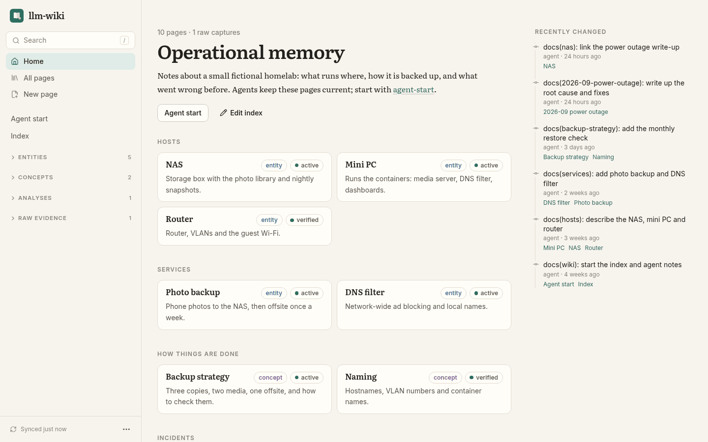
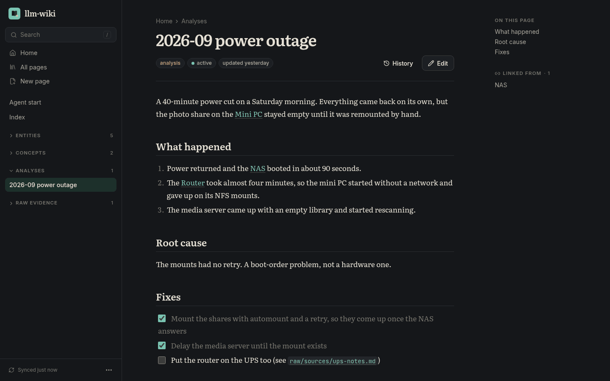

# llm-wiki-web

A web app for reading and editing a wiki that lives in a Git repository as
Markdown files, the kind of wiki coding agents keep up to date as they work. I
use it to read what my agents wrote down, fix it from my phone, and tick off
checklists without opening an editor.





## What it does

It clones the repository, shows the pages with `[[wiki links]]`, backlinks,
search and a recent-changes feed, and lets you edit them in CodeMirror. Each
save is a commit that gets pushed straight away; there is no database. If an
agent changed the same page while you were editing, you get a three-way merge
to review instead of a silent overwrite. Before a save is committed, the wiki's
own checker (`tools/wiki_check.js`) runs on it, so whatever rules the wiki has
are enforced here too.

Smaller things: checkboxes on a page can be ticked directly, renaming a page
rewrites the links to it, new pages start from the repository's templates, and
commit subjects follow a `docs(<area>): …` convention (optionally written by
an LLM through an OpenAI-compatible endpoint).

[docs/how-it-works.md](docs/how-it-works.md) has the details on syncing,
saving, conflicts and sign-in.

## The wiki repository

The app expects:

- `wiki/**/*.md` pages with YAML frontmatter (`type`, `status`, `updated`)
- `wiki/index.md`, which becomes the home page: its `## Sections` of
  `- [[page]] — description` lines turn into cards
- optionally `raw/` for captured source material, `templates/` for new pages,
  and `tools/wiki_check.js`, a Node script that validates the wiki

## Running it locally

Point it at a scratch copy, never at the real repository:

```sh
nix develop
npm ci
git clone --bare <your wiki repository> /tmp/wiki.git
LLM_WIKI_REPO_URL=/tmp/wiki.git LLM_WIKI_DATA_DIR=/tmp/llm-wiki-data \
  LLM_WIKI_SETUP_TOKEN=local-setup-token-123456 \
  cargo run --manifest-path backend/Cargo.toml   # API on :3002
npm run dev                                      # UI on :3102, proxies /api
```

Open the UI, enter the setup token and choose the owner password.

## Configuration

| Variable                                   | Purpose                                                                            |
| ------------------------------------------ | ---------------------------------------------------------------------------------- |
| `LLM_WIKI_REPO_URL`                        | repository to clone (required)                                                     |
| `LLM_WIKI_BRANCH`                          | branch, default `main`                                                             |
| `LLM_WIKI_SSH_KEY_FILE`                    | deploy key with write access, for GitHub over SSH                                  |
| `LLM_WIKI_DATA_DIR`                        | clone and `auth.json`, default `./data`                                            |
| `LLM_WIKI_SETUP_TOKEN`                     | needed once to set the owner password (16+ characters)                             |
| `LLM_WIKI_ORIGIN`                          | public URL, e.g. `https://wiki.example.com`; checked on writes                     |
| `LLM_WIKI_GIT_NAME` / `LLM_WIKI_GIT_EMAIL` | commit author                                                                      |
| `LLM_WIKI_AI_URL` / `_KEY` / `_MODEL`      | optional OpenAI-compatible endpoint for commit subjects                            |
| `LLM_WIKI_OIDC_*`                          | optional passkey sign-in, see [docs/how-it-works.md](docs/how-it-works.md#sign-in) |

## Deploying

CI publishes `ghcr.io/fruitiex/llm-wiki-web`. The image listens on port 8080,
keeps its clone in `/data`, and includes Node for the wiki's checker. Give it a
deploy key for the repository and the setup token, and put it behind your own
reverse proxy. It's meant for one owner on a private network; with
`LLM_WIKI_OIDC_*` set you can sign in through your OpenID Connect provider
instead of the password.

## Development

The backend is Rust (axum). The frontend is React 19, Tailwind v4 and Radix,
built with Vite. CodeMirror only loads when you open the editor, to keep
reading fast on a phone.

```sh
nix develop
npm run typecheck && npm run format:check
cargo clippy --manifest-path backend/Cargo.toml --all-targets -- -D warnings
cargo test --manifest-path backend/Cargo.toml   # real git repos: conflicts, push retries, rewrites, auth
npm run build && npm run test:ui                 # drives the built app in Chromium, see scripts/verify-ui.mjs
```

`npm run test:ui` writes screenshots to `test-results/`. CI also smoke-tests
the container against a throwaway wiki with `scripts/smoke-ui.mjs`.
